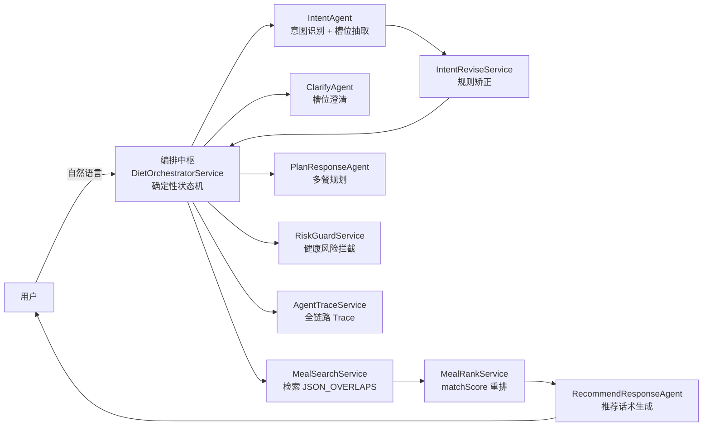

# diet-agent

面向「不知道吃什么」的就餐决策场景，基于 **Spring Boot + AgentScope** 的多 Agent 对话式饮食推荐系统。

用户用一句话描述需求（餐次、口味、健康目标、场景…），系统通过多个专职 Agent 协作，完成「意图识别 → 槽位澄清 → 检索重排 → 推荐生成」的完整链路，并配套全链路 Trace 可观测与离线评估体系。

## 核心设计

- **编排型多 Agent 架构**：编排中枢（确定性状态机）+ 专职 Worker（意图识别 / 槽位澄清 / 推荐生成 / 多餐规划 / 评估裁判）。核心思想「**决策归规则，表达归 LLM**」——路由、检索、排序、风险拦截全部由 Java 规则控制，LLM 只负责「理解」和「表达」两处。
- **意图识别多级保障**：LLM 识别 6 类意图 + 7 维槽位 → 规则矫正（健康风险前置 / 无历史降级 / 多餐规划强制 / 低置信降级）→ 关键词 Fallback 兜底。
- **槽位词典白名单**：7 维槽位（餐次 / 心情 / 场景 / 健康目标 / 菜系 / 口味 / 便捷性）经词典白名单强约束，防止 LLM 幻觉标签流入检索。
- **检索 + 重排**：MySQL `JSON_OVERLAPS` 召回 + 7 维 `matchScore` 打分重排。
- **全链路 Trace**：每轮对话采集关键节点输入 / 输出事件落库，支持线上问题回放与回溯。
- **离线评估闭环**：后端规则 + LLM Judge + 用户反馈加权打分，覆盖 10+ 指标，支持人工标注与 prompt / 规则迭代。
- **全链路 Fallback**：LLM 超时 / 异常时由关键词规则与固定模板降级接管，保证业务不中断、对话始终有回复。

## 架构



## 技术栈

- Java 21、Spring Boot 3.3.13
- AgentScope 1.0.11（多智能体框架，Spring Boot Starter）
- MyBatis 3.0.4、MySQL 8
- 通义千问（阿里云 DashScope），支持大小模型分层（主模型 qwen-max / 轻模型 qwen-turbo，配置可切换）
- Hutool、Lombok

## 快速开始

### 环境要求

- JDK 21、Maven 3.8+
- MySQL 8
- 一个 DashScope API Key

### 步骤

1. **初始化数据库**：执行 `src/main/resources/db/diet_db.sql`（建表 + 餐食数据）。
2. **配置**：复制 `src/main/resources/application.yml.example` 为 `application.yml`，填入你的 MySQL 密码和 DashScope API Key。
3. **启动**：`mvn spring-boot:run`（默认端口 8080）。
4. **打开** `http://localhost:8080` 进入对话界面。

> `application.yml` 含真实密钥，已加入 `.gitignore`，请勿提交。

## 目录结构（核心）

```
src/main/java/com/diet/
├── agent/          # Agent 构建器与工厂
├── orchestrator/   # 编排中枢（状态机）
├── service/
│   ├── intent/     # 意图识别 + 规则矫正
│   ├── clarify/    # 槽位澄清
│   ├── meal/       # 检索 + 重排
│   ├── recommend/  # 推荐话术
│   ├── plan/       # 多餐规划
│   ├── risk/       # 健康风险拦截
│   ├── trace/      # 全链路 Trace
│   └── evaluation/ # 离线评估
└── controller/     # REST 接口
```
